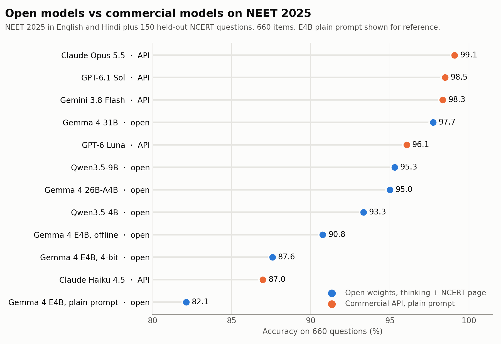

# neet-open-pipeline

Code for building a bilingual (English + Hindi) NEET-UG dataset from the official NTA papers, linking every question to its NCERT textbook passage, and evaluating open and commercial models on NEET 2025.

**Headline:** with thinking mode on and the relevant NCERT passage in the prompt, open-weight models come within a point of the commercial ones: Gemma 4 31B scores 97.7% against Gemini 3.8 Flash's 98.3%, and Qwen3.5-4B scores 93.3%. Three LoRA fine-tunes of Gemma 4 E4B did not beat the untrained model. Full tables: [docs/results.md](docs/results.md).



## What is here

| Stage | Scripts |
|---|---|
| Inputs: paper inventory, page rendering, official answer keys | `inventory_papers.py`, `render_pages.py`, `parse_answer_keys.py` |
| Question extraction with a vision model, with a fallback ladder for refused pages | `extract_pages.py`, `fix_paper.py`, `relocate_figures.py` |
| Assembly, bilingual merge and checks | `assemble_questions.py`, `merge_bilingual.py`, `check_questions.py`, `crosscheck_text.py` |
| NCERT: chunking, embedding, question-to-passage linking | `chunk_ncert.py`, `embed_ncert.py`, `link_ncert.py` |
| Generated training data (explanations, NCERT-based questions) and its blind check | `gen_synthetic.py`, `verify_mcq.py` |
| Evaluation set, dev probe, retrieval for the eval | `build_eval.py`, `build_dev_probe.py`, `build_eval_passages.py` |
| Running models: open models on Modal with vLLM, commercial models by API | `modal_eval.py`, `eval_api.py`, `eval_common.py` |
| Scoring and paired comparison with bootstrap intervals | `score_eval.py`, `compare_runs.py` |
| Offline retrievers compared | `eval_retrievers.py`, `modal_retrievers.py` |
| Fine-tuning (LoRA on Modal) and its data builders | `modal_train.py`, `spawn_train.py`, `build_train.py`, `build_train_v2.py`, `build_v3_prompts.py`, `modal_v3_sample.py`, `modal_sample.py`, `build_train_v3.py` |
| Diagnostics and charts | `adapter_drift.py`, `capture_train_log.py`, `blog_charts.py`, `runlog.py` |

`eval/` holds the ids of the 660 evaluation items and of the held-out and validation sets, so the splits can be reproduced.

## What is not here

The data is not in this repository: the NTA question papers, the NCERT text, the generated training data and the model outputs. The scripts expect it under `data/`. The dataset is available on request.

## Running

Python 3.12. Install with `pip install -r requirements.txt`, copy `.env.example` to `.env` and fill in the keys you need. GPU work runs on [Modal](https://modal.com); see the docstring at the top of each script for its usage.

```bash
modal run scripts/modal_eval.py --model google/gemma-4-E4B-it --think --passage retrieved
```

## Licence

Code: Apache 2.0. NEET question papers and answer keys are published by the National Testing Agency; NCERT textbooks are © NCERT. Neither is included here.
