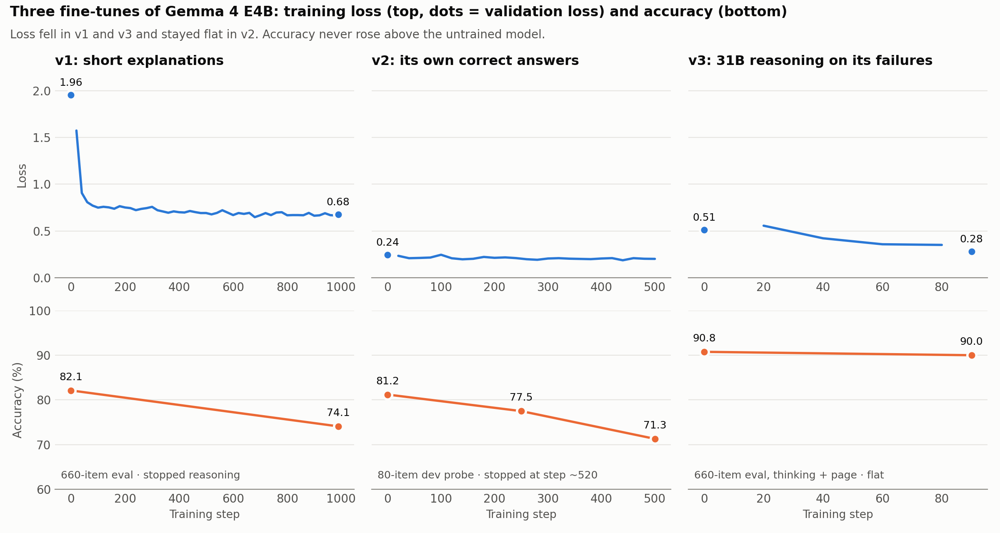

# Results

Accuracy in %, on 660 items: the whole NEET 2025 paper (180 questions) in English and in Hindi, plus 150 NCERT-based questions held out from training, also in both languages. 46 items have figures. Every model gets the same prompt, images and answer parser (`scripts/eval_common.py`); scores are re-parsed from saved outputs by `scripts/score_eval.py`. The item list is in `eval/eval_v1_items.json`.

"Setup" means the model's thinking mode is on and the top NCERT passage, retrieved by embedding search within the subject, is placed above the question.

## Open models with the setup, commercial models with a plain prompt

| Model | Weights | Setup | All | NEET EN | NEET HI | Figures |
|---|---|---|---:|---:|---:|---:|
| Claude Opus 5.5 | API | plain prompt | 99.1 | 98.9 | 97.8 | 95.7 |
| GPT-6.1 Sol | API | plain prompt | 98.5 | 98.3 | 96.7 | 95.7 |
| Gemini 3.8 Flash | API | plain prompt | 98.3 | 97.8 | 97.2 | 95.7 |
| Gemma 4 31B | open | setup | 97.7 | 96.1 | 96.1 | 91.3 |
| GPT-6 Luna | API | plain prompt | 96.1 | 95.6 | 92.8 | 87.0 |
| Qwen3.5-9B | open | setup | 95.3 | 94.4 | 91.1 | 71.7 |
| Gemma 4 26B-A4B | open | setup | 95.0 | 91.1 | 93.3 | 82.6 |
| Qwen3.5-4B | open | setup | 93.3 | 93.3 | 86.1 | 63.0 |
| Gemma 4 E4B, offline retriever | open | setup | 90.8 | 88.3 | 83.9 | 47.8 |
| Gemma 4 E4B, Google's 4-bit build | open | setup | 87.6 | 83.3 | 78.3 | 50.0 |
| Claude Haiku 4.5 | API | plain prompt | 87.0 | 88.3 | 80.0 | 47.8 |
| Gemma 4 E4B | open | plain prompt | 82.1 | 81.7 | 70.0 | 47.8 |

Only the 4-bit row is quantised; the other open models were evaluated at full precision. The offline retriever is Qwen3-Embedding-0.6B; the Qwen3.5 rows also used it, and the other Gemma rows used Gemini's embedding for retrieval. Paired 95% intervals on the 660 set are about ±2.5 points.

## What each part of the setup adds (Gemma 4 E4B)

| Setup | All | NEET HI | Physics | Chemistry |
|---|---:|---:|---:|---:|
| Plain prompt | 82.1 | 70.0 | 81.6 | 81.1 |
| Thinking on | 86.5 | 80.6 | 91.1 | 82.6 |
| NCERT passage | 86.8 | 75.6 | 84.2 | 87.4 |
| Both | 89.8 | 81.1 | 89.5 | 89.5 |
| Both, offline retriever | 90.8 | 83.9 | 88.9 | 90.0 |

## Fine-tuning Gemma 4 E4B (LoRA r=16)

| Run | Training targets | Result |
|---|---|---|
| v1 | Short Gemini explanations + generated questions (15.8k) | 82.1 → 74.1 on the 660 eval |
| v2 | E4B's own correct answers (17.4k) | dev probe 81.2 → 71.3, stopped |
| v3 | Gemma 4 31B thinking traces on prompts E4B fails, with setup (1.5k) | 90.8 → 90.0 on the 660 eval (−0.8, 95% CI −3.0 to +1.7) |

## Thinking budget (Gemma 4 E4B, setup, offline retriever)

| Max output tokens | Accuracy | Answers cut off |
|---:|---:|---:|
| 8,192 | 90.8 | 1 |
| 2,560 | 87.0 | 40 |
| 1,536 | 75.6 | 143 |
